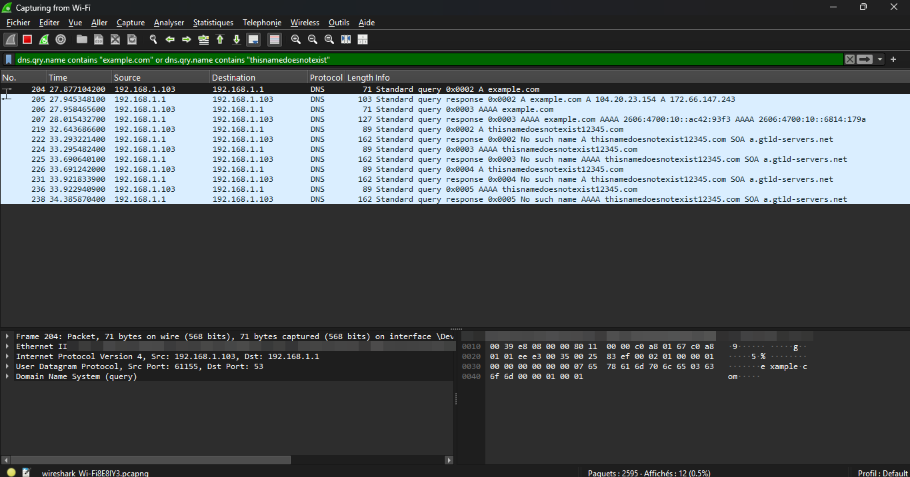

# Wireshark Troubleshooting Casebook

> A packet-analysis casebook documenting repeatable Windows network tests, protocol-level observations, troubleshooting hypotheses, and practical next steps.

[](https://www.wireshark.org/)
[](#case-studies)

## Project purpose

This project demonstrates a structured troubleshooting workflow: reproduce a network operation, capture the relevant traffic, isolate packets with display filters, interpret protocol behavior, distinguish evidence from hypotheses, and document the next diagnostic action.

**Environment:** Windows 11 PC on a Wi-Fi home network. These are personal lab investigations, not customer incidents or enterprise network captures.

## Case studies

| # | Investigation | What the capture demonstrates | Documentation |
|---|---|---|---|
| 01 | DHCP address assignment | DORA exchange, lease options, retransmission observation and missing-packet troubleshooting | [DHCP](cases/01-dhcp.md) |
| 02 | DNS name resolution | Successful A/AAAA lookup, NXDOMAIN, DNS response timing and resolver diagnostics | [DNS](cases/02-dns.md) |
| 03 | ARP neighbor resolution | Broadcast request, unicast reply, dynamic ARP cache entry and gateway reachability | [ARP](cases/03-arp.md) |
| 04 | ICMP connectivity | Echo Request / Echo Reply and interpretation of packet loss or missing replies | [ICMP](cases/04-icmp.md) |
| 05 | TCP connection establishment | SYN, SYN-ACK, ACK sequence and successful HTTPS connection setup | [TCP handshake](cases/05-tcp-handshake.md) |
| 06 | TCP connection refusal | SYN followed by RST, ACK; distinguish active refusal from a silent timeout | [Failed TCP connection](cases/06-failed-connection.md) |

## Selected packet-analysis evidence



Case-specific captures and command output are linked from each investigation. Screenshots are filtered to the relevant test traffic; identifying MAC addresses are blurred where applicable.

## Troubleshooting workflow

1. **Define the symptom.** Identify the affected service or destination and record the expected behavior.
2. **Establish a baseline.** Check local addressing and gateway configuration with Windows networking tools.
3. **Reproduce the operation.** Use a focused command such as `ipconfig /renew`, `nslookup`, `ping`, or `curl`.
4. **Capture and filter.** Use Wireshark display filters to isolate the relevant protocol, endpoint, port, or stream.
5. **Interpret packet behavior.** Identify request/response sequences, errors, retransmissions, resets, and missing replies.
6. **Separate facts from hypotheses.** A packet trace may show a reset, for example, without proving whether the cause is a closed service or a rejecting firewall.
7. **Document next checks.** Provide a practical checklist to validate the suspected cause.

## Useful Wireshark filters

```wireshark
dhcp
dns
arp
icmp && ip.addr == 192.168.1.1
tcp.flags.syn == 1 && tcp.flags.ack == 0
tcp.port == 81
```

For a specific investigation, use the more focused filter documented in that case. Stream numbers and transaction IDs are capture-specific and should not be copied into a different capture.

## Tools and skills

- **Wireshark:** packet capture, display filters, stream inspection and protocol dissection.
- **Windows networking:** `ipconfig`, `arp`, `ping`, `nslookup`, and `curl`.
- **Protocols:** DHCP, DNS, ARP, ICMP, TCP and basic TLS connection context.
- **Troubleshooting:** layer-aware diagnosis, evidence-based interpretation, hypothesis validation and technical reporting.

## Repository structure

```text
cases/
  01-dhcp.md
  02-dns.md
  03-arp.md
  04-icmp.md
  05-tcp-handshake.md
  06-failed-connection.md
screenshots/
README.md
```

## Scope and limitations

- Captures come from a Windows 11 PC and a home Wi-Fi network.
- Private RFC 1918 addresses are used in the local-network examples.
- A packet capture shows observed network behavior; it does not always prove the underlying cause. Each case identifies uncertainty where applicable.
- The casebook is a learning and portfolio project, not a claim of production incident-response experience.

## Author

**Mohamed Ali Tijani**  
**Career focus:** System & Network Administration · IT Support · Network Technician

[GitHub profile](https://github.com/Medalitijani) · [LinkedIn](https://www.linkedin.com/in/mohamed-ali-tijani-0ab3a236b/)
