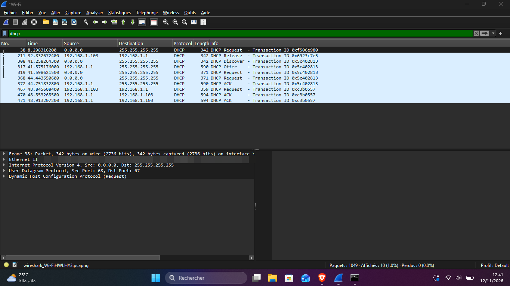
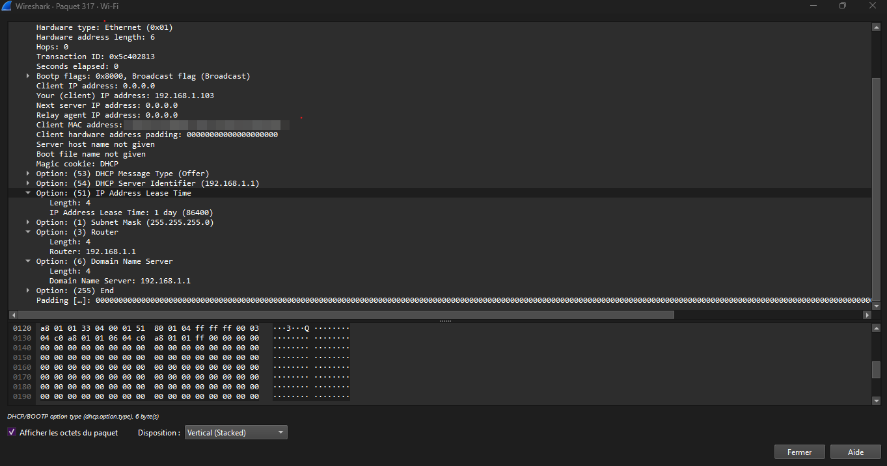

# Case 1: DHCP, how a PC gets its IP address

## Symptom

A PC that has just joined a network (or renewed its connection) must get an IP address before it can do anything else. When DHCP fails, the PC ends up with no address or a `169.254.x.x` address and no internet. I captured a normal exchange to document what a healthy one looks like.

## Setup

- Capture on the Wi-Fi interface of a Windows 11 PC, filter `dhcp`
- Triggered with `ipconfig /release`, then `ipconfig /renew`
- Network: home router at 192.168.1.1 acting as the DHCP server

## Capture

| Packet | Sender | What it does |
|---|---|---|
| Discover | PC (broadcast, 0.0.0.0) | "Is there a DHCP server? I need an address." |
| Offer | Router 192.168.1.1 | Proposes an address and settings |
| Request | PC (broadcast) | "I accept this offer." |
| ACK | Router 192.168.1.1 | Confirms the lease |

All four packets share one Transaction ID (`0x5c402813`), which is how I isolated the exchange with the filter `dhcp.id == 0x5c402813`.

## What the Offer contains

| Field | Value |
|---|---|
| Offered address | 192.168.1.103 |
| Subnet mask | 255.255.255.0 |
| Router (default gateway) | 192.168.1.1 |
| DNS server | 192.168.1.1 |
| Lease time | 1 day (86400 s) |
| Broadcast flag | Set, because the PC has no address yet |

## Observations

- Discover to Offer took about 0.3 s. The ACK arrived about 3.5 s after the Discover.
- The PC sent its Request twice (about 3 s apart) before the ACK arrived. I did not find the cause in the capture; the Wi-Fi was reconnecting after the release, so a short delay is plausible but not proven.
- A few seconds later the PC renewed the lease with a unicast Request to the router, which answered with an ACK. Renewal does not repeat the Discover and Offer steps.

## Diagnosis: what a missing packet means

| What you see | Likely meaning |
|---|---|
| Discover, no Offer | No DHCP server reachable (cable or Wi-Fi problem, DHCP service off, wrong VLAN) |
| Offer, no Request | The PC rejected or never received the offer |
| Request, no ACK | The server refused the request or did not answer (address conflict, pool exhausted) |
| Offer from an unexpected IP | A second, unauthorized DHCP server on the network (rogue DHCP) |

## Fix checklist

1. Check the physical link (cable, Wi-Fi signal) and the switch or access point port.
2. Confirm the DHCP service is running on the router or server, and that the pool has free addresses.
3. Run `ipconfig /release`, then `ipconfig /renew`, and re-check with `ipconfig /all`.
4. If the address is `169.254.x.x`, Windows gave up on DHCP: repeat from step 1.
5. In a VLAN network, make sure the VLAN has a DHCP pool or a DHCP relay.

## Privacy note

MAC addresses are blurred in the screenshots. Only private (RFC 1918) addresses are shown.
