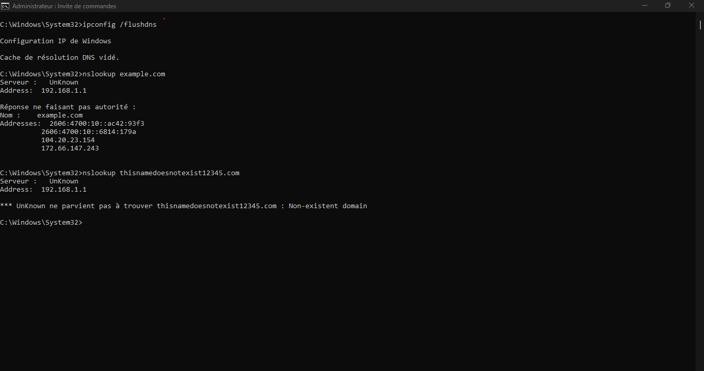
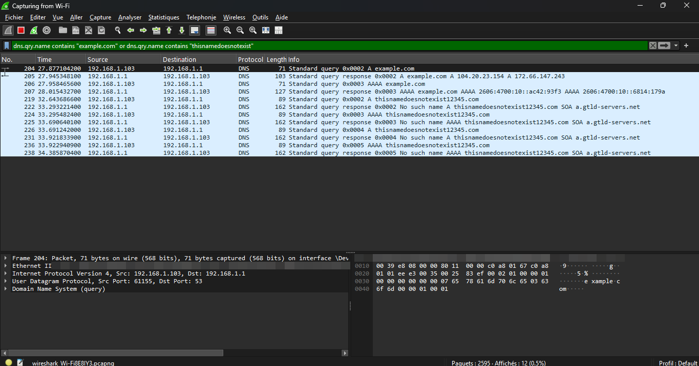

# Case 2: DNS, resolving a name (and what a failed lookup looks like)

## Symptom

"The internet doesn't work" is often a DNS problem: the PC has a network connection but cannot turn a name into an IP address. I captured one lookup that works and one that fails, to show the difference.

## Setup

- Windows 11 PC, Wi-Fi capture in Wireshark, filter on the two names
- DNS server: the home router (192.168.1.1), as given by DHCP in Case 1
- Commands run (after emptying the cache):

```
ipconfig /flushdns
nslookup example.com
nslookup thisnamedoesnotexist12345.com
```



## Capture



## Successful lookup: example.com

| Packet | What it shows |
|---|---|
| Query (type A) | The PC asks the router for the IPv4 address of example.com |
| Response | Two IPv4 addresses: 104.20.23.154 and 172.66.147.243 (about 70 ms) |
| Query (type AAAA) | The PC also asks for the IPv6 address |
| Response | Two IPv6 addresses: 2606:4700:10::ac42:93f3 and 2606:4700:10::6814:179a |

- DNS uses UDP, with destination port 53.
- `nslookup` labels the answer "Non-authoritative": the router answered from its own cache or by forwarding, not as the owner of the domain.

## Failed lookup: a name that does not exist

| Packet | What it shows |
|---|---|
| Query (A and AAAA) | The PC asks for thisnamedoesnotexist12345.com |
| Response | **No such name** (NXDOMAIN), with an SOA record from a.gtld-servers.net |

- `nslookup` prints "Non-existent domain".
- The answer took about 0.65 s, much slower than the cached-style answer for example.com.
- The same name was queried several times with different query IDs. I did not determine why from the capture (possibly retries or lookup attempts by `nslookup`).

## Why "Server: UnKnown" appears in nslookup

Before the real lookup, `nslookup` asks the router for the name of the DNS server itself (a reverse lookup of 192.168.1.1, shown as `1.1.168.192.in-addr.arpa`). The router answers "No such name", so `nslookup` prints "UnKnown". It is a cosmetic message, not an error: the lookups still work.

## Diagnosis: what you see and what it means

| What you see | Likely meaning |
|---|---|
| Query, no response | DNS server unreachable, or blocked (check the link, the server address, the firewall) |
| Response "No such name" (NXDOMAIN) | The name does not exist or is mistyped; the DNS server itself is working |
| Response "Server failure" | The DNS server could not resolve it (upstream problem) |
| Response with an address, but the site fails | DNS is fine; look at routing, a firewall or the web server |

## Fix checklist

1. Test by IP first: `ping 8.8.8.8`. If it works but `ping example.com` fails, it is DNS.
2. Check which DNS server the PC uses: `ipconfig /all`.
3. Empty the cache: `ipconfig /flushdns`.
4. Test with another DNS server: `nslookup example.com 8.8.8.8`.
5. If the router's DNS is faulty, restart it or change the DNS servers in the DHCP settings.

## Privacy note

MAC addresses are blurred in the screenshots. The capture was filtered to the two test names, so none of my browsing traffic is shown.
