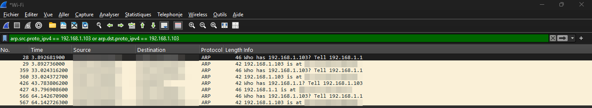
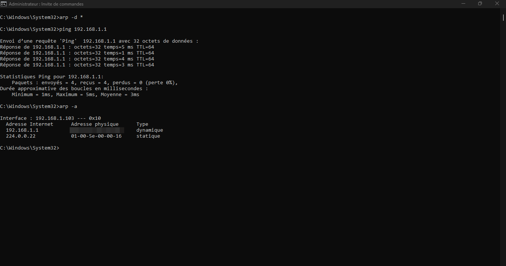

# Case 3: ARP, how a PC finds a neighbor's MAC address

## Symptom

On a local network, a PC knows the IP address of the device it wants to reach (for example its gateway), but frames are delivered using MAC addresses. ARP is the step that maps one to the other. When ARP fails, the PC cannot reach even devices on its own subnet.

## Setup

- Windows 11 PC on Wi-Fi, filter showing only ARP packets involving this PC
- ARP cache emptied, then a ping to the router:

```
arp -d *
ping 192.168.1.1
arp -a
```

## Capture



MAC addresses are blurred.

## The exchange

| Packet | Info | Type |
|---|---|---|
| ARP request | "Who has 192.168.1.1? Tell 192.168.1.103" | Broadcast (sent to everyone on the LAN) |
| ARP reply | "192.168.1.1 is at [router MAC]" | Unicast (sent only to the asking PC) |

The PC then stores the answer in its ARP table:



The entry for 192.168.1.1 is marked "dynamic": it was learned, and it expires after a while. The entry for 224.0.0.22 is a built-in multicast address and is "static".

## Observations

- The router also sent ARP requests asking for my PC's address, about every 30 seconds in this capture. I believe it was refreshing its own ARP table, but the capture does not prove it.
- Other ARP requests from the router (for addresses that did not answer) appeared in a wider capture. I did not investigate why they went unanswered.

## Diagnosis: what you see and what it means

| What you see | Likely meaning |
|---|---|
| ARP requests with no reply | The target is offline, blocked, or on a different VLAN or subnet |
| Two replies with different MACs for one IP | An IP address conflict (or ARP spoofing) |
| Request for the gateway repeated, no reply | The default gateway is down or unreachable |
| ARP table shows "incomplete" or no entry for the gateway | PC cannot resolve the gateway; check cable, Wi-Fi and VLAN |

## Fix checklist

1. Confirm the PC's IP, mask and gateway (`ipconfig`): ARP only works inside the same subnet.
2. Empty the cache and retry: `arp -d *`, then `ping <gateway>`.
3. Check the physical link, switch port and VLAN.
4. If two devices share an address, look for the duplicate with `arp -a` and change one of them.
5. Remember that ARP does not cross routers: to reach another subnet, the PC asks for the gateway's MAC, not the destination's.

## Privacy note

MAC addresses are blurred in all screenshots, and the capture was filtered to packets involving only my own PC.
