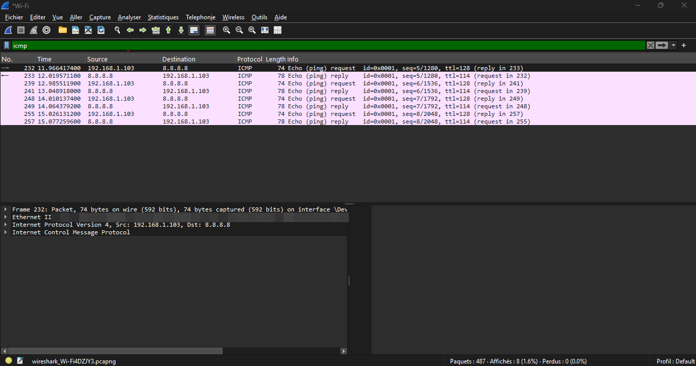

# Case 4: ICMP – Testing Network Connectivity with Ping

## Symptom

When a computer cannot access a network device or server, the administrator needs a simple way to test connectivity.

ICMP (Internet Control Message Protocol) is used by the ping command to check whether another device is reachable over an IP network.

## Setup

- Windows 11 PC connected to Wi-Fi.
- Command Prompt used to test connectivity.
- Wireshark used to capture ICMP packets.
- Destination: 192.168.1.1 (default gateway).

Command executed:

```cmd
ping 192.168.1.1
```

## Capture



## The exchange

| Packet | Meaning |
|---|---|
| ICMP Echo Request | The PC sends a request to the destination. |
| ICMP Echo Reply | The destination responds to confirm connectivity. |

## Observations

- Echo Request packets were sent from the PC to the gateway.
- Echo Reply packets were received from the gateway.
- The response time indicates the time required for a reply.
- Successful replies indicate that the gateway is reachable through IP.

## Diagnosis: What you see and what it means

| What you see | Likely meaning |
|---|---|
| Echo Request and Echo Reply | Successful connectivity |
| Echo Request without a reply | Destination unreachable or ICMP blocked |
| Destination unreachable | A routing or network connectivity problem |
| High response time | Possible congestion or network latency |
| Packet loss | Possible unstable connectivity |

## Fix checklist

1. Check the network connection using `ipconfig`.
2. Verify the default gateway.
3. Test the gateway using `ping 192.168.1.1`.
4. Check the network cable, Wi-Fi and switch connection.
5. Investigate packet loss and high latency.
6. Check firewall rules if ICMP traffic is blocked.

## Conclusion

ICMP is a useful troubleshooting protocol for testing basic IP connectivity. Wireshark allows administrators to observe Echo Requests and Echo Replies and identify possible network communication problems.

## Privacy note

The screenshot should not expose personal information, public IP addresses or MAC addresses.
