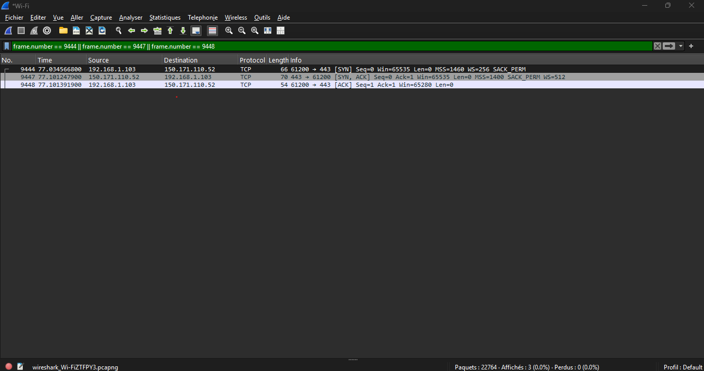

# Case 5: TCP Three-Way Handshake

## Symptom

Before two devices can exchange data using TCP, they must establish a connection.

TCP uses a three-way handshake to synchronize both devices and confirm that communication can begin.

## Setup

- Windows 11 PC connected to Wi-Fi.
- Wireshark used to capture network traffic.
- HTTPS connection generated using `curl https://example.com`.
- Destination TCP port: 443.
- TCP stream index: 29.

Command executed:

```cmd
curl https://example.com
```

## Capture



## The Three-Way Handshake

The capture shows three packets establishing the TCP connection.

| Packet | TCP Flag | Meaning |
|---|---|---|
| 9444 | SYN | The client requests a TCP connection. |
| 9447 | SYN, ACK | The server acknowledges the request and responds. |
| 9448 | ACK | The client acknowledges the server's response. |

## Observations

- The client IP address was 192.168.1.103.
- The server IP address was 150.171.110.52.
- The client used source port 61200.
- The server used destination port 443 (HTTPS).
- The TCP handshake completed successfully.
- TLS communication followed the TCP connection establishment.

## Diagnosis: What You See and What It Means

| What you see | Likely meaning |
|---|---|
| SYN without a response | Server unavailable, traffic filtered or network problem |
| SYN followed by SYN, ACK | Server received and accepted the connection request |
| SYN, ACK without final ACK | Client may not have completed the handshake |
| SYN, SYN, ACK, ACK | TCP connection successfully established |
| Repeated SYN packets | Possible connection timeout or packet loss |

## Fix Checklist

1. Check the destination IP address and TCP port.
2. Verify network connectivity.
3. Check firewall rules that may block TCP traffic.
4. Verify that the destination service is listening on the expected port.
5. Use Wireshark to inspect SYN, SYN-ACK and ACK packets.
6. Investigate retransmissions and connection timeouts.

## Conclusion

The TCP three-way handshake is essential for establishing reliable TCP communication.

Wireshark makes it possible to identify the three handshake packets and verify whether a TCP connection was successfully established.

## Privacy Note

The screenshot focuses on the three handshake packets. MAC addresses and packet detail panels are not displayed.
