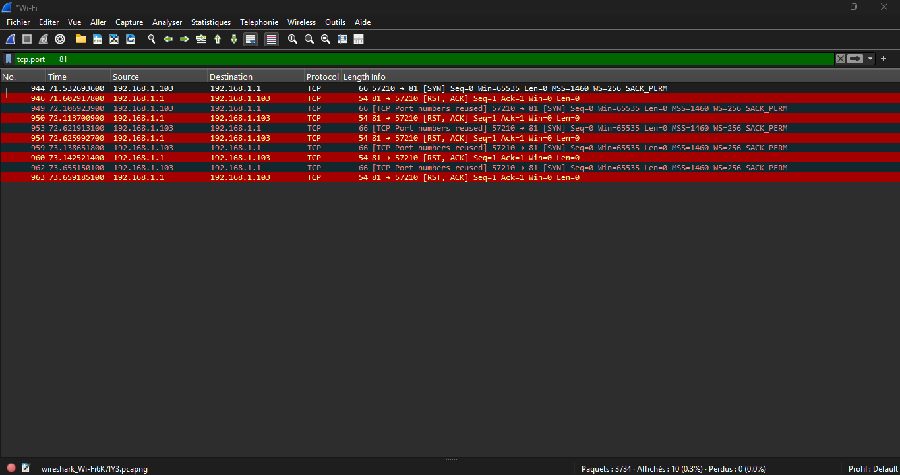

# Case 6: Troubleshooting a Failed TCP Connection

## Symptom

A client computer attempts to connect to a network device using TCP, but the connection fails.

In this case, the PC attempted to connect to TCP port 81 on the default gateway (192.168.1.1).

The connection was refused.

## Setup

- Windows 11 PC connected to Wi-Fi.
- Wireshark used to capture TCP traffic.
- Destination IP: 192.168.1.1.
- Destination TCP port: 81.
- Display filter: `tcp.port == 81`.

Command executed:

```cmd
curl --connect-timeout 10 http://192.168.1.1:81
```

Result:

```text
curl: (7) Failed to connect to 192.168.1.1:81
Could not connect to server
```

## Capture



## Packet Analysis

The capture shows the following exchange:

| Packet | TCP Flag | Meaning |
|---|---|---|
| 944 | SYN | The client requests a connection to port 81. |
| 946 | RST, ACK | The destination immediately resets the connection. |
| 949, 953, 957, 962 | SYN | The client makes additional connection attempts. |
| 950, 954, 958, 963 | RST, ACK | The destination continues rejecting the attempts. |

## Observations

- The client IP address is 192.168.1.103.
- The destination IP address is 192.168.1.1.
- The client uses TCP port 57210.
- The destination port is 81.
- The destination responded with RST, ACK packets, indicating an active connection reset. This is consistent with a closed port or a firewall configured to reject the connection. The packet capture alone cannot distinguish between these causes.
- The connection is refused rather than established.
- The repeated SYN and RST, ACK exchanges confirm that the connection cannot be established.

## Diagnosis: What You See and What It Means

| What you see | Likely meaning |
|---|---|
| SYN followed by RST, ACK | Connection actively refused or reset |
| Repeated SYN without response | Possible firewall filtering or unreachable destination |
| SYN, SYN-ACK, ACK | Successful TCP connection |
| Destination unreachable | Routing or network connectivity problem |
| Connection timeout | No successful response within the timeout period |

## Fix Checklist

1. Verify the destination IP address.
2. Check whether the destination service is running.
3. Confirm that the service listens on the expected TCP port.
4. Check firewall rules that may reject incoming connections.
5. Test another known open port.
6. Use Wireshark to inspect SYN, ACK and RST packets.
7. Verify that the router or destination device is reachable.

## Conclusion

Wireshark helped identify why the TCP connection failed.

The destination responded with RST, ACK packets, indicating that the connection attempt was actively refused.

This demonstrates how packet analysis can distinguish an actively rejected TCP connection from a connection timeout.

## Privacy Note

The capture was filtered to TCP port 81. MAC addresses and packet detail panels should not be exposed in the published screenshot.
